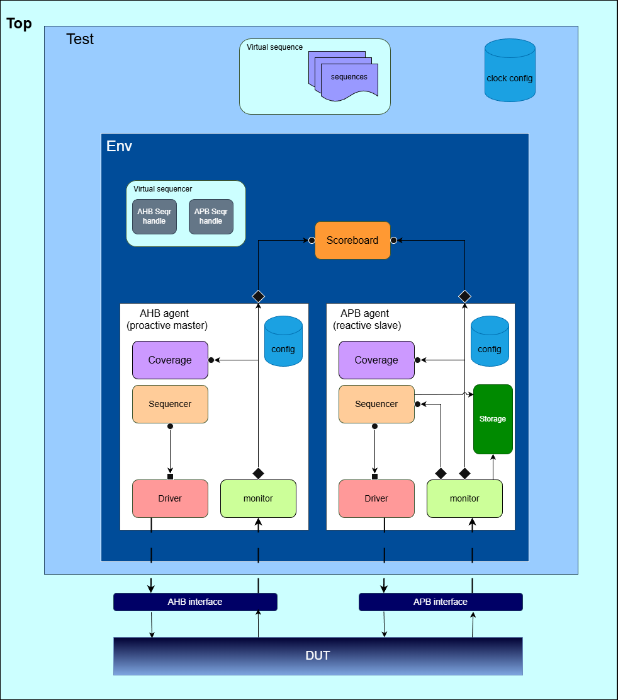
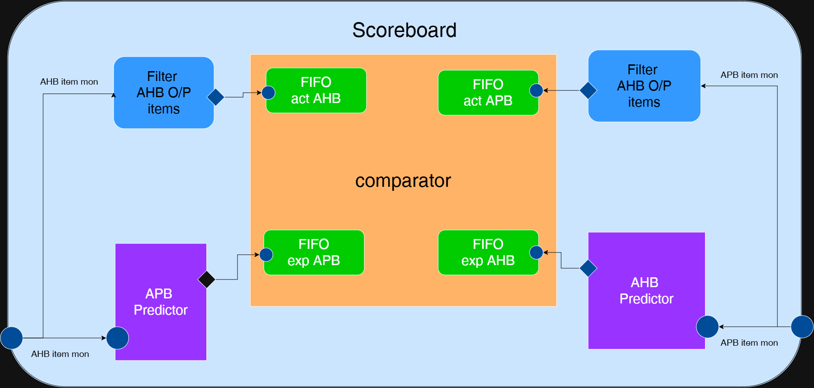

# AHB-to-APB Asynchronous Bridge — UVM Verification

A SystemVerilog/UVM verification environment for the ARM CMSDK AHB to ABP Asychronous bridge. In this project, layered agents, a memory modeled APB Agent, a self-checking scoreboard, protocol assertions, and functional coverage is used to verify the correctness of AHB-to-APB transaction conversion.

## Repository Layout

```text
agents/       AHB and APB UVM agents
rtl/          AHB-to-APB bridge RTL
scripts/      Simulation and waveform/coverage scripts
tb/           Testbench top, environment, scoreboard, assertions
tests/        Directed and virtual-sequence test scenarios
docs/coverage/ QuestaSim HTML coverage report
docs   Testbench and scoreboard architecture diagrams and coverage file
Makefile      Compile, run, multiple test ,and coverage targets
```

## Architecture

### UVM Testbench Architecture




### Scoreboard Architecture




## Key Features

- **Layered UVM agents:** separate AHB and APB sequencers, drivers, monitors, configuration objects, and coverage collectors.

- **APB Agent Memory Model:** associative-array storage with byte-strobe support, plus configurable no-wait, randomized-wait, and error-response scenarios.

- **Self-checking scoreboard:** predicts expected AHB/APB behavior and compares it with monitored transactions.

- **Protocol assertions:** AHB and APB assertions that check the tranisition validity rules and cross assertions that check bridge signal translations.

- **Functional coverage:** covers transfer types, address offsets and alignment, transfer size, protection attributes, read/write and response transitions, APB byte strobes, and reset during an active transfer.

## Verification Scenarios

The verification plan covers reset behavior, AHB-to-APB transaction translation, response handling, and operation under different clock configurations.

| Scenario | Test Description | Verification Goal |
|---|---|---|
| **Asynchronous Reset** | Assert the active-low reset at startup and at scheduled points during traffic, including while AHB or APB transfers are in progress. | Check that reset is applied asynchronously and that the bridge signals respond correctly. |
| **Write Transfers — No Wait States** | Generate back-to-back writes with no wait states and randomized delays between transfers. | Verify AHB-to-APB write translation and APB-to-AHB response handling. |
| **Write Transfers — With Wait States** | Generate back-to-back writes with wait states between address and data phases and randomized delays. | Verify correct write translation and response handling under wait states. |
| **Write Transfers — Overlapping Phases** | Generate writes with wait states and overlapping address/data phases. | Verify correct handling of overlapping write phases. |
| **Read Transfers — No Wait States** | Generate back-to-back reads with no wait states and randomized delays between transfers. | Verify AHB-to-APB read translation and response handling. |
| **Read Transfers — With Wait States** | Generate back-to-back reads with wait states between address and data phases and randomized delays. | Verify correct read translation and response handling under wait states. |
| **Read Transfers — Overlapping Phases** | Generate reads with wait states and overlapping address/data phases. | Verify correct handling of overlapping read phases. |
| **Mixed Read/Write Transfers** | Randomize write-to-read and read-to-write sequences with wait states, overlapping phases, and delays. | Verify correct translation and response handling across mixed transactions. |
| **Partial Writes** | Exercise valid combinations of `HSIZE` and `HADDR[1:0]`. | Verify the mapping of transfer size and address alignment to APB `PSTRB`. |
| **Protection Attributes** | Exercise valid `HPROT` combinations during write transfers. | Verify the mapping from AHB `HPROT` to APB `PPROT`. |
| **Error Responses** | Assert `PSLVERR` randomly during APB transfers. | Verify that APB slave errors are correctly reflected on AHB `HRESP`. |
| **Constrained-Random Stress Test** | Generate randomized, protocol-compliant transfers. | Check overall bridge functionality across varied transaction sequences and timing conditions. |
| **Equal Clock Frequencies** | Run the test scenarios with equal AHB and APB clock frequencies. | Verify correct operation across the sequences with matched clock frequencies. |
| **AHB Clock at Twice the APB Frequency** | Run the test scenarios with the AHB clock frequency twice the APB clock frequency. | Verify correct bridge operation with this clock-frequency ratio. |
| **Double-Frequency Clock with Phase Shift** | Use an AHB clock at twice the APB frequency and shift its phase by half a clock cycle. | Verify correct operation with the specified frequency ratio and phase offset. |

### Verification Approach

- **Reference Model:** Compare observed transactions and responses against expected behavior.

- **Assertions:** Check asynchronous reset behavior and relevant protocol requirements.

- **Constrained-Random Sequences:** Vary transfer types, wait states, phase overlap, delays, and clock configurations.

- **Functional Coverage:** Track exercised scenarios and combinations to identify verification gaps.

## Results

The committed QuestaSim 2021.1 coverage report was generated on **12 October 2026**. Its reported snapshot is:

| Metric | Result |
|---|---:|
| Overall design-unit coverage | **100%** |
| DUT instance coverage | **100%** |
| Statement coverage | 100% (92/92) |
| Branch coverage | 100% (78/78) |
| Expression coverage | 100% (39/39) |
| Condition coverage | 100% (6/6) |
| Assertion checks | 100% (52/52) |
| Cover directives | 100% (31/31) |
| Toggle coverage | 100% (1366/1366) |
| FSM states / transitions | 100% (7/7 states, 13/13 transitions) |
| Functional covergroup bins hit | 95/95 |

## Language and Tool Used

SystemVerilog · UVM · QuestaSim · Make
